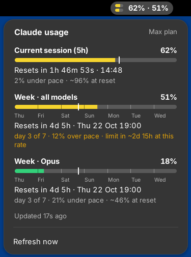

# claude-usage

A small terminal dashboard for your Claude (Pro/Max) plan limits: the current
**5-hour session**, the **weekly** limits, and a live countdown until each one
resets. It comes in two forms:

- **A terminal app**: one Python file with no dependencies.
- **A GNOME top-bar extension**: an indicator next to the clock and wifi, with
  a popup. See [GNOME top bar](#gnome-top-bar-ubuntu).

`claude-usage report` shows **what used up your limits**, per chat and per
prompt, and why. See [What used my limits?](#what-used-my-limits).

This is a beta built on an undocumented Anthropic endpoint, so it can
break without notice.

## Quick start

**You need:**
- A Claude **Pro or Max** plan.
- A login in **Claude Code**, the command-line tool. The Claude desktop app
  keeps its login where other programs can't read it, so it doesn't count. If
  you don't have Claude Code yet:
  ```bash
  curl -fsSL https://claude.ai/install.sh | bash
  claude          # then type /login and pick your Claude account
  ```
- For the top bar: Ubuntu / GNOME. It's tested on Ubuntu 24.04 (GNOME 46).

**Install:**

```bash
git clone https://github.com/DavidSchledewitz/DavidSchledewitz.git
cd DavidSchledewitz

# Top-bar indicator. Afterwards, log out and back in once.
./claude-usage/gnome-extension/install_claude_bar.sh

# Terminal app, as the command `claude-usage` in any folder
mkdir -p ~/.local/bin
ln -sf "$PWD/claude-usage/claude_usage.py" ~/.local/bin/claude-usage
```

If `~/.local/bin` didn't exist before, open a new terminal. Then:

```bash
claude-usage            # full live view (r = refresh, q = quit)
claude-usage --window   # small separate window
```

**Update:** `git pull`. The terminal app is updated right away. For the
top bar, run `install_claude_bar.sh` again and log out and back in.

**Remove:** `./claude-usage/gnome-extension/install_claude_bar.sh --uninstall`
and `rm ~/.local/bin/claude-usage`.

**Something looks wrong?**
- *Login expired*: it's normally renewed automatically. If that fails, the
  top bar shows **⚠ log in** and a notification pops up. Click the
  notification (or its **Log in** button, or **Log in to Claude…** in the
  popup). In the terminal view, press `l`, or run `claude-usage --login`.
  Each of these runs Claude Code's own login: your browser opens, you
  confirm, and the numbers come back by themselves.
- *Retrying in…*: the usage server is rate-limiting. It retries by itself.
- Anything else: send a screenshot and the output of `gnome-shell --version`.

## What it shows

```
 Claude usage · Max plan

 Current session (5h)                                               62%
 ███████████████████████████████████████████░┃░░░░░░░░░░░░░░░░░░░░░░░░░
 resets in 1h 47m 08s · at 14:29
 2% under pace · ~96% at reset

 Week · all models                                                  51%
 ██████████▓█████████▓██████┃██▓█████░░░░│░░░░░░░░░│░░░░░░░░░│░░░░░░░░░
 Thu       Fri       Sat       Sun       Mon       Tue       Wed
 resets in 4d 5h · at Thu 22 Oct 18:42
 day 3 of 7 · 12% over pace · limit in ~2d 15h at this rate

 updated 2s ago · next in 57s · [r] refresh  [q] quit
```

How to read it:

- The bar turns green, yellow or red at 50% and 80%.
- `┃` marks **now**: how much of the window has passed. If the fill stops
  left of it, you're under pace.
- On weekly bars, a tick marks each day. Each segment is one day's even share
  (about 14%) of the weekly budget. Days run from your reset time to the same
  time the next day, not midnight to midnight. Each segment is labelled with
  the day it mostly covers: with a Sunday 20:00 reset, the first one is Mon.
- "x% over/under pace" compares your usage with an even burn across the
  window. The last part extrapolates your current rate linearly. It's shown
  in yellow when you're over pace.

## Other ways to run the terminal app

- **Without installing:** `python3 claude-usage/claude_usage.py`. It needs
  Python 3.8+ and no packages.
- **With pipx:** `pipx install ./claude-usage`. Re-run it after each update.
  (Plain `pip install --user` is blocked on Ubuntu 24.04.)
- The `~/.local/bin` link from the Quick start is the easiest option: it
  points at the repo, so `git pull` updates it.

## Usage

| Command | What it does |
|---|---|
| `claude-usage` | Live dashboard. Polls every 5 min and ticks every second. `r` refreshes, `q` quits. |
| `claude-usage -c`, `--compact` | Small live dashboard (about 42×6). It's used automatically when the window is under 50 columns. |
| `claude-usage -w`, `--window` | Opens the compact dashboard in its own small GNOME Terminal window, zoomed out to 0.8 and without a menu bar. |
| `claude-usage --once` | Prints the dashboard once (add `-c` for the small one). |
| `claude-usage --line` | Prints one line, e.g. `5h 62% (1h47m) · wk 34% (4d5h)` |
| `claude-usage --json` | Prints the raw API response. |
| `claude-usage report` | What used your limits, per chat and per prompt, as a page in your browser. See [What used my limits?](#what-used-my-limits). |
| `claude-usage --login` | Logs in again with Claude Code's own login (`claude auth login`), which opens your browser. In the live view, `l` does the same when the login has expired. |
| `--zoom 0.7` | Font scale for `--window` (1.0 = normal). |
| `-i 600`, `--interval 600` | Seconds between polls in live mode (default 300, minimum 60). |
| `--cache-ttl 600` | How old cached data `--line` may reuse (default 300 s). |
| `--no-color` / `NO_COLOR=1` | Plain output. |
| `--no-renew` | Don't renew an expired login (see [How it works](#how-it-works)). |
| `--version`, `-h` | Version, help. |

Environment variables: `CLAUDE_CONFIG_DIR` (where Claude Code's login lives,
default `~/.claude`), `CLAUDE_CODE_OAUTH_TOKEN` (use this token instead),
`XDG_CACHE_HOME` (cache location), `NO_COLOR`.

### A keyboard shortcut for the small window

Open Settings, then Keyboard, then View and Customize Shortcuts, then Custom
Shortcuts, and click **+**:

- Name: `Claude usage`
- Command: `/home/YOUR_USER/.local/bin/claude-usage --window` (use the full
  path; shortcuts don't always see `~/.local/bin`)
- Shortcut: whatever you like, e.g. Super+U

GNOME on Wayland doesn't let apps place their own windows, so the window
opens wherever GNOME puts it. Drag it to a corner. To keep it above other
windows, right-click its title bar and choose **Always on Top**.

### In a status bar

`--line` reuses a cached result for up to 5 min (`--cache-ttl`) and shares the
cache with the live dashboard, so it's cheap to call often.

**tmux** (`~/.tmux.conf`):
```tmux
set -g status-interval 30
set -g status-right '#(claude-usage --line)'
```

**Claude Code status line** (`~/.claude/settings.json`):
```json
{ "statusLine": { "type": "command", "command": "claude-usage --line" } }
```

## What used my limits?

```bash
claude-usage report
```

This writes `~/.cache/claude-usage/report.html` and opens it. It shows:

- **5-hour and weekly windows**: how each window filled up over time, split
  by chat, with the real `/usage` percentage drawn on top. Hover for the
  numbers at any moment, click a band to open that chat.
- **Chats**: which chats used the most in the selected window, the week, or
  everything, and what kind of usage it was.
- **One chat**: how fast it used your limit (with 5h resets marked), and every
  prompt with its share, the tools it ran, the context size of each call and
  the reasons it was expensive, e.g. *"46 model calls, each re-reading the
  conversation (~240k tokens)"*, *"cache expired after 2h 10m idle: the whole
  conversation was cached again"*, *"4 subagents: each starts its own
  context"*, *"106k tokens written, 43k of it thinking"*.

The terminal prints a short summary too. Options: `--days 35` (how far back),
`-o FILE`, `--no-open`, `--no-fetch`, `--json`.

**Why one prompt can cost more than twenty.** Every step of a prompt (each
tool call) sends the whole conversation to the model again. Twenty short
questions in fresh chats are cheap; one long agentic prompt deep into a big
chat repeats a large context dozens of times. Coming back to a chat after the
cache expired (5 min or 1 h) pays to cache the whole conversation again.
Subagents each build their own context. And output, thinking included, costs
5x as much as input per token.

**How the percentages work.** Claude Code saves every model call with its
token counts in `~/.claude/projects`. Anthropic doesn't publish how tokens
turn into percent of your limits, so the report learns it: the terminal app
and the top bar log every usage reading to
`~/.local/share/claude-usage/history.jsonl` (about 30 KB a day). A reading
says "X% used since this window started"; the transcripts say which tokens
were used in the same time. Fitting the two gives "percent per token",
weighted by model and token type using API prices. One reading is enough for
a rough number; it gets better the longer the top bar or `claude-usage` runs.
The report page shows the typical error. Without any readings, amounts are
API-equivalent dollars.

**What it can't see.** claude.ai chats, the desktop app, Claude Code on the
web and other computers count against the same limits but leave no
transcripts here. The window charts show that part as the gap between the
measured line and the colored area, and the calibration gives each window
its own offset for it, so it doesn't inflate the per-token rate.

## GNOME top bar (Ubuntu)



The top-bar icon shows two mini bars: the 5h session on top and the week
below. Next to them are both percentages. Click it for the popup: every
limit, a live countdown, day ticks on the weekly bars and the pace note.

Install it for your user:

```bash
./gnome-extension/install_claude_bar.sh
```

Then **log out and back in once**. GNOME on Wayland only picks up new
extensions at login, and the same goes after updating the code.
`./gnome-extension/install_claude_bar.sh --uninstall` removes it.

Notes:

- It's tested on GNOME 46 (Ubuntu 24.04). It declares support up to GNOME 50
  (Ubuntu 26.04), but those versions are untested. If it doesn't show up
  after an upgrade, run `journalctl -o cat -b /usr/bin/gnome-shell | grep -i claude`
  to see why.
- It needs nothing beyond GNOME itself: no Python, no extra packages. It
  reads the same login and calls the same endpoint as the terminal app, and
  it shares the cache in `~/.cache/claude-usage/`. The terminal app and the
  extension can run side by side without doubling the requests.
- It polls every 5 minutes. The endpoint rate-limits eagerly (HTTP 429); then
  it backs off (10, 20, then 30 min) or waits as long as the server asks,
  whichever is longer, and keeps showing the last numbers. While you're locked, GNOME turns
  extensions off, so it doesn't poll then.

## How it works

Claude Code stores your claude.ai login in one of these places:

- Linux/Windows: `~/.claude/.credentials.json` (or `$CLAUDE_CONFIG_DIR`)
- macOS: Keychain item `Claude Code-credentials`
- Or set `CLAUDE_CODE_OAUTH_TOKEN` yourself (e.g. from `claude setup-token`)

The tool reads that token **read-only** and calls
`GET https://api.anthropic.com/api/oauth/usage`, the same endpoint behind
`/usage` in Claude Code. The token never goes anywhere else.

Things to know:

- **This endpoint is undocumented.** Anthropic can change it without notice.
  The parser is generic, so a new limit type (anything with a `utilization`
  field) shows up automatically. If the format changes completely, run
  `claude-usage --json` to see what came back.
- **It renews an expired login by itself.** Claude Code's login lasts only
  some hours, and Claude Code renews it whenever you use it. If you haven't,
  claude-usage renews it the same way Claude Code does (same login server,
  same request) and writes the fresh login back into
  `~/.claude/.credentials.json`, so Claude Code keeps working with it too. It
  only does this once the login has expired or been rejected, keeps every
  other field in that file, writes it in one step, and uses a lock so the top
  bar and the terminal app never renew at the same time. The small risk: if
  Claude Code renews in the very same moment, it may need one `/login`. If
  renewing fails for good, you get the **Log in to Claude…** button instead.
  This relies on how Claude Code logs in today, which Anthropic can change.
  To turn it off, create `~/.config/claude-usage/no-auto-renew` (both apps),
  or pass `--no-renew` to the terminal app.
- It works with subscription (Pro/Max) logins only. API-key usage has no
  5h/weekly limits.

## Tests

```bash
python3 -m unittest -v test_claude_usage     # terminal app, includes a fake-server end-to-end run
python3 -m unittest -v test_claude_usage_report   # report: transcripts, calibration, page
gjs -m gnome-extension/tests/test_usage.js   # extension's parsing/pace logic
```
